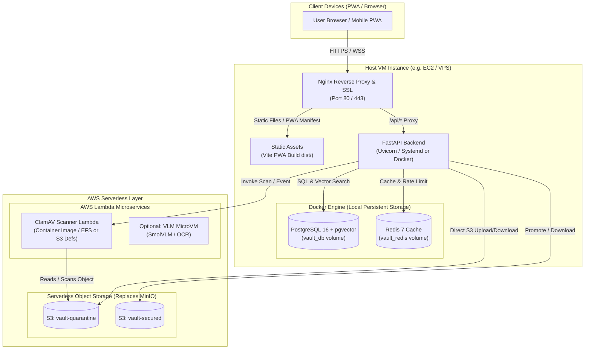

# Vault City AI: Production Deployment Plan

This deployment blueprint organizes **Vault City AI** into a hybrid architecture:
- **Core Host Instance (EC2 / VPS):** Houses Nginx (serving the Vite PWA build and SSL termination), the FastAPI backend, PostgreSQL with `pgvector`, and Redis.
- **Serverless Cloud Layer (AWS Lambda & S3):** Replaces self-hosted local MinIO with native **AWS S3** (zero-maintenance, 100% serverless object storage) and runs **ClamAV antivirus scanning** in an ephemeral AWS Lambda container.

---

## 1. High-Level Architecture



---

## 2. Serverless Storage & Antivirus Clarifications

### Why AWS S3 Replaces MinIO Serverlessly
> [!NOTE]
> **MinIO** is a stateful file server designed for persistent disks; running MinIO *inside* AWS Lambda is not practical because Lambda has ephemeral filesystems and a 15-minute maximum lifecycle.
>
> In the cloud, **AWS S3** is the native, serverless drop-in replacement for MinIO. 
> 
> Because Vault City's `backend/app/services/s3_service.py` is already built using `boto3`, **zero backend code changes are required**. When `MINIO_ENDPOINT_URL` is omitted, `boto3` automatically communicates directly with AWS S3 using standard AWS IAM credentials or EC2 instance roles.

### ClamAV on AWS Lambda
ClamAV is packaged into an AWS Lambda container image (`public.ecr.aws/lambda/python:3.12` with `clamav` and `freshclam`):
1. **Definition Updates:** Virus database files (`main.cvd`, `daily.cvd`) are updated daily via an automated EventBridge cron task and synced to an S3 definitions bucket or AWS EFS.
2. **Execution Flow:**
   - When a user uploads a document, the backend uploads it directly to `vault-quarantine`.
   - The backend invokes the `vault-file-scan-extract` Lambda (already defined in `lambdas/template.yaml`) or S3 triggers the Lambda via an ObjectCreated event.
   - Lambda streams the file, runs `clamscan`, and returns `{ "is_clean": true/false, "threat_name": ... }`.
   - If clean, the file is promoted to `vault-secured`. If infected, it is deleted and quarantined immediately.

---

## 3. Host Instance Configuration

### A. Docker Services on Host Instance
Create a lean `docker-compose.prod.yml` on the host running only the persistent stateful datastores:

```yaml
version: '3.8'

services:
  db:
    image: pgvector/pgvector:pg16
    container_name: vault_db
    restart: always
    environment:
      POSTGRES_DB: vault_db
      POSTGRES_USER: ${POSTGRES_USER}
      POSTGRES_PASSWORD: ${POSTGRES_PASSWORD}
    volumes:
      - postgres_data:/var/lib/postgresql/data
    ports:
      - "127.0.0.1:5432:5432"

  redis:
    image: redis:7-alpine
    container_name: vault_redis
    restart: always
    command: redis-server --appendonly yes --requirepass ${REDIS_PASSWORD}
    volumes:
      - redis_data:/data
    ports:
      - "127.0.0.1:6379:6379"

volumes:
  postgres_data:
  redis_data:
```

### B. FastAPI Backend
Run as a systemd service or lightweight container on the instance:
- Managed by `systemd` (`/etc/systemd/system/vault-backend.service`):
  ```ini
  [Unit]
  Description=Vault City AI FastAPI Backend
  After=network.target

  [Service]
  User=ubuntu
  WorkingDirectory=/opt/vaultcity/backend
  ExecStart=/opt/vaultcity/backend/.venv/bin/uvicorn app.main:app --host 127.0.0.1 --port 8000 --workers 4
  Restart=always
  EnvironmentFile=/opt/vaultcity/backend/.env

  [Install]
  WantedBy=multi-user.target
  ```

### C. Frontend Vite PWA Build & Nginx
1. Build frontend on build machine or CI/CD:
   ```bash
   cd frontend
   npm run build
   # Outputs optimized static files to frontend/dist/
   ```
2. Copy `frontend/dist/` to `/var/www/vaultcity/dist/` on the host instance.
3. Nginx serves `dist/` directly with HTTP/2 and caching, proxying `/api` requests to `127.0.0.1:8000`.

---

## 4. Step-by-Step Rollout Plan

### Phase 1: AWS Serverless Setup (S3 & Lambda)
1. **Create S3 Buckets:**
   - `vault-quarantine-<unique-id>`
   - `vault-secured-<unique-id>`
   - `vault-clamav-defs-<unique-id>` (stores ClamAV definitions)
2. **Deploy ClamAV Lambda:**
   - Use the existing `lambdas/template.yaml` (or deploy the containerized ClamAV scan handler to AWS Lambda with 2048MB memory).
   - Configure IAM role allowing Lambda read/write access to quarantine bucket.

### Phase 2: Host Instance Setup
1. **Provision VM:** Ubuntu 22.04 or 24.04 LTS (e.g. AWS EC2 `t3.large` / `t4g.large` or equivalent VPS).
2. **Install Essentials:** Docker, Docker Compose, Git, Python 3.12, Nginx, Certbot.
3. **Launch Database & Redis:** Start `docker-compose.prod.yml` and run database migrations (`alembic upgrade head`).

### Phase 3: Application Deployment
1. **Deploy Backend:** Clone repo, set production `.env`, setup Python virtualenv, and start `vault-backend` systemd service.
2. **Deploy Frontend:** Build Vite static assets (`npm run build`) and place them in `/var/www/vaultcity/dist`.

### Phase 4: Domain & SSL
1. Configure DNS `A` record pointing to the instance public IP.
2. Run Certbot to generate trusted SSL certificates:
   ```bash
   sudo certbot --nginx -d yourvaultdomain.com
   ```
3. Test PWA installation on mobile and desktop over HTTPS.

---

## 5. Production Environment Variables Reference

| Variable | Recommended Production Value | Note |
| :--- | :--- | :--- |
| `ENVIRONMENT` | `production` | Enforces secure cookies & strict CORS |
| `ALLOWED_ORIGINS` | `https://yourvaultdomain.com` | Restricts API access to your domain |
| `DATABASE_URL` | `postgresql+asyncpg://...` | Connects to local Docker pgvector |
| `REDIS_URL` | `redis://:password@127.0.0.1:6379/0` | Secured with password |
| `S3_QUARANTINE_BUCKET` | `vault-quarantine` | AWS S3 Bucket |
| `S3_SECURED_BUCKET` | `vault-secured` | AWS S3 Bucket |
| `MINIO_ENDPOINT_URL` | *Leave Empty / None* | Directs boto3 to real AWS S3 |
| `AWS_REGION` | `us-east-1` (or your choice) | Region for S3 and Lambda |
| `SAM_API_URL` | `https://<api-id>.execute-api...` | Deployed ClamAV Lambda API Gateway |
