# Implementation Plan: AWS SAM Local Lambda Pipeline (Virus Scan, Isolated VLM Image MicroVM, ML Security Scan & PostgreSQL `pgvector` Ingestion)

This plan configures **AWS SAM (Serverless Application Model)** for local AWS Lambda development integrated with the existing **Vault City** (`quick-search-ai`) Docker infrastructure (`vault_network`, **PostgreSQL 16 + `pgvector`**, Redis, FastAPI), featuring a **3-Lambda security & multimodal RAG pipeline**.

> [!NOTE]
> **Completed Prerequisite:** ChromaDB has been removed and replaced with **`pgvector/pgvector:pg16`**, the `document_chunks` table (`vector(384)` + HNSW cosine index), Alembic migration `d4e8a1b2c3f4`, and [`vector_service.py`](../backend/app/services/vector_service.py).

---

## 1. End-to-End 3-Lambda Architecture

```mermaid
flowchart LR
    Client["FastAPI Backend / Local SAM Event"] --> S3["MinIO (Local S3) / File Payload"]
    S3 --> L1["Lambda 1: FileScanAndExtractFunction"]

    subgraph Stage1["Stage 1: Virus Scan & Text Extraction"]
        L1 --> ClamAV["ClamAV Daemon (clamav:3310)"]
        ClamAV -- "INFECTED" --> Reject1["Quarantine & Mark scan_status=infected"]
        ClamAV -- "CLEAN" --> Extract["Text Extractor (PDF / DOCX / TXT)"]
        Extract --> Check{"Image or Unreadable / Sparse Text?"}
    end

    subgraph Stage1B["Stage 1B: Isolated VLM MicroVM Lambda (Zero DB/Secrets Access)"]
        Check -- "Yes (Image / Scanned PDF)" --> L3["Lambda 3: ImageVLMDescriptionFunction"]
        L3 --> VLM["Quantized VLM (SmolVLM-500M / Moondream2)"]
        VLM --> Desc["Rich Visual Description + Visible Text"]
    end

    Check -- "No (Clean Text Extracted)" --> L2["Lambda 2: TextSecurityAndVectorizeFunction"]
    Desc -- "Combined Description + Text" --> L2

    subgraph Stage2["Stage 2: ML Security & pgvector Ingestion"]
        L2 --> SQLi["ML Model 1: SQL Injection Classifier (ONNX)"]
        L2 --> PromptInj["ML Model 2: AI Prompt Injection Classifier (ONNX)"]
        SQLi & PromptInj -- "THREAT DETECTED" --> Reject2["Block & Mark scan_status=blocked_*"]
        SQLi & PromptInj -- "SAFE" --> Chunk["Recursive Text Chunker + FastEmbed (384-dim)"]
        Chunk --> PGVector["PostgreSQL + pgvector (db:5432 / document_chunks)"]
    end
```



---

## 2. MicroVM Reality Check & Isolation Strategy (Local macOS vs AWS Cloud)

### How MicroVMs Work with AWS SAM & AWS Lambda
- **In AWS Production:** Every AWS Lambda function *natively* executes inside an **AWS Firecracker microVM** (hardware-virtualized isolation, up to 10 GB RAM, 6 vCPUs, 10 GB container image, CPU-only).
- **On macOS Locally:** Native Linux Firecracker requires `/dev/kvm` (Linux KVM), which macOS does not expose directly. Instead, **AWS SAM CLI (`sam local`)** runs each Lambda inside an isolated Linux container backed by macOS's native **Apple Virtualization Framework microVM** (via Docker Desktop VMM / OrbStack / Colima).
- **Zero-Privilege Sandbox Design for Lambda 3 (`ImageVLMDescriptionFunction`):**
  - Image parsers (`libjpeg`, `libpng`, PDF rasterizers) and VLMs carry higher memory and parser-exploit risk.
  - By isolating VLM inference in its **own dedicated Lambda function (`ImageVLMDescriptionFunction`)** with:
    - **No PostgreSQL credentials**, **no Redis access**, **no S3 write permissions**, and **read-only root filesystem** (`--read-only` + ephemeral `/tmp`),
    - Only the quantized VLM weights loaded in memory,
    - It runs as a pure stateless **Image → Description + Visible Text** microVM boundary in AWS (Firecracker) and locally (SAM Docker container).
  - **Visual Prompt Injection Defense:** Because Lambda 3's output always routes into **Lambda 2**, even malicious instructions hidden inside an image (*visual prompt injection*, e.g. white-on-white text `"Ignore previous instructions..."`) are caught by Lambda 2's ML Prompt Injection scanner before touching `pgvector`!

---

## 3. Key Architectural Decisions

### A. Lambda Packaging: `PackageType: Image` (Docker Container Lambdas)
- All 3 Lambdas use **`public.ecr.aws/lambda/python:3.12`** container images (`PackageType: Image`, up to 10 GB limit).
- Model weights are baked into Docker build layers during `sam build` for deterministic offline local runs.
- **macOS Apple Silicon Optimization:** Configure `Architectures: [arm64]` (parameterized in `template.yaml`) to run natively on Apple Silicon without slow x86 QEMU emulation.

### B. Unified Database + VectorDB (`pgvector` in Existing `db` Container)
- `db` (`pgvector/pgvector:pg16`) stores both relational records (`files`, `audit_logs`) and `document_chunks.embedding vector(384)` with HNSW cosine indexing.
- Backing services added to `docker-compose.yml` on `vault_network`:
  1. **`clamav` (`clamav/clamav:stable`)** — Persistent ClamAV daemon (`clamav:3310`) for <100ms TCP `INSTREAM` virus scanning.
  2. **`minio` (`minio/minio:latest`)** *(Optional)* — Local S3-compatible bucket (`minio:9000`) alongside `file_base64` support for quick CLI testing.

### C. Model Selection (CPU-Friendly, Fast & Accurate)

| Lambda | Model / Runtime | Footprint | Purpose |
| :--- | :--- | :--- | :--- |
| **Lambda 1** | ClamAV `INSTREAM` + `pymupdf` (`fitz`) + `python-docx` | ~150 MB | Antivirus scan, PDF/DOCX/TXT extraction, page-to-PNG rasterization for scanned PDFs |
| **Lambda 3 (VLM MicroVM)** | **`SmolVLM-500M-Instruct` (Q4/Q8 GGUF via `llama-cpp-python`)** *(default)* or **`Moondream2` (INT4 ONNX)** | ~500 MB – 1.2 GB | Understands images & unreadable scans; generates structured visual description + visible text (no GPU needed; optional `VLM_MODE=ollama` for Apple Metal acceleration locally) |
| **Lambda 2 (ML Security)** | `cssupport/mobilebert-sql-injection-detect` (ONNX) + `ProtectAI/deberta-v3-small-prompt-injection-v2` (ONNX) | ~450 MB | Sliding-window SQL injection & AI prompt injection / manipulator text scanning |
| **Lambda 2 (Embeddings)** | `fastembed` (`BAAI/bge-small-en-v1.5`, 384-dim ONNX) | ~60 MB | Generates 384-dim vectors matching `document_chunks.embedding vector(384)` |

---

## 4. Proposed Directory Structure

```text
quick-search-ai/
├── docker-compose.yml                      # [MODIFY] Add clamav (and optional minio) on vault_network
├── backend/
│   └── app/
│       └── services/
│           └── lambda_pipeline.py          # [NEW] boto3 client helper to invoke local SAM Lambdas
└── lambdas/
    ├── template.yaml                       # [NEW] AWS SAM template (3 Functions, API Gateway routes, Env Vars)
    ├── samconfig.toml                      # [NEW] SAM CLI config (--docker-network vault_network)
    ├── env.json                            # [NEW] Local env overrides (Postgres pgvector, ClamAV, MinIO, VLM mode)
    ├── Makefile                            # [NEW] Helpers: sam-build, sam-api, sam-lambda, test-all
    ├── events/                             # [NEW] Sample local test events
    │   ├── clean_document_event.json
    │   ├── eicar_virus_event.json
    │   ├── image_vlm_event.json            # [NEW] Image / unreadable scan test event for Lambda 3
    │   ├── sqli_payload_event.json
    │   └── prompt_injection_event.json
    ├── file_scanner_extractor/             # [NEW] Lambda 1: Virus Scan + Text Extraction + Image Routing
    │   ├── Dockerfile
    │   ├── requirements.txt
    │   ├── scanner.py                      # ClamAV TCP INSTREAM client + magic byte validation
    │   ├── extractor.py                    # PDF (pymupdf), DOCX, TXT + sparse-text detection & page rasterizer
    │   └── app.py                          # Lambda handler (routes images/unreadable pages -> Lambda 3 -> Lambda 2)
    ├── image_vlm_describer/                # [NEW] Lambda 3: Isolated VLM MicroVM (Image -> Description + Text)
    │   ├── Dockerfile                      # Self-contained Lambda image with baked SmolVLM GGUF/ONNX weights
    │   ├── requirements.txt
    │   ├── download_vlm.py                 # Downloads quantized SmolVLM-500M / Moondream2 at build time
    │   ├── vlm_engine.py                   # Embedded llama.cpp/ONNX runner + optional local Ollama Metal adapter
    │   └── app.py                          # Zero-DB, zero-secret stateless Lambda handler
    └── ml_security_vectorizer/             # [NEW] Lambda 2: ML Security Scan + Chunking + pgvector
        ├── Dockerfile                      # Bakes ONNX security + FastEmbed models into image
        ├── requirements.txt
        ├── download_models.py              # Downloads & caches ONNX models at build time
        ├── scanners/
        │   ├── __init__.py
        │   ├── normalizer.py               # Unicode NFKC & zero-width obfuscation detector
        │   ├── sqli_scanner.py             # ML SQL Injection classifier (sliding window)
        │   └── prompt_injection_scanner.py # ML AI Prompt Injection / Manipulator classifier
        ├── chunker.py                      # Recursive splitter preserving page metadata
        ├── pgvector_store.py               # FastEmbed + psycopg3/pgvector atomic upsert into document_chunks
        └── app.py                          # Lambda handler
```

---

## 5. Detailed Component Design

### Stage 1 — Lambda 1: `FileScanAndExtractFunction` (`1024 MB RAM`, `60s timeout`)
1. **Fetch & Validate:** Load bytes from MinIO/S3 (`s3_bucket`/`s3_key`) or decode `file_base64`. Compute SHA-256 and enforce 25 MB limit.
2. **Virus Scan:** Stream bytes to `clamav:3310` (`INSTREAM`). If `FOUND`, immediately halt and return `{ status: "infected", threat_name }`.
3. **Text Extraction & VLM Fallback Decision:**
   - Extract text from PDF (`pymupdf`), DOCX (`python-docx`), or plain text.
   - **Trigger Lambda 3 (VLM) automatically when:**
     - File is an image (`image/png`, `image/jpeg`, `image/webp`), **OR**
     - File is a PDF whose extracted text has `< 50` non-whitespace characters per page (scanned/handwritten/diagram PDF — rasterize page to PNG at 150 DPI via `pymupdf` and send to Lambda 3).
4. **Handoff:** Combine extracted text + any VLM visual descriptions and forward to Lambda 2.

### Stage 1B — Lambda 3: `ImageVLMDescriptionFunction` (`3072 MB RAM`, `120s timeout`, Isolated MicroVM)
- **Strict Least-Privilege Environment:** Zero database env vars, zero secret keys, zero network dependencies in `embedded` mode.
- **Input Event Contract:**
  ```json
  {
    "file_id": "uuid",
    "filename": "scanned_prescription.jpg",
    "mime_type": "image/jpeg",
    "image_base64": "<base64-encoded-image>",
    "page_number": 1
  }
  ```
- **Execution Steps:**
  1. Safely decode & resize image (`max_dim=1024px`, strip EXIF metadata, convert to RGB) via `Pillow` to prevent decompression bombs (`Image.MAX_IMAGE_PIXELS`).
  2. Run quantized VLM (`SmolVLM-500M-Instruct` embedded or optional local `ollama` in dev) with a structured system prompt asking for:
     - **Visual Summary:** What the image depicts (scene, document type, diagrams, charts, photos, key entities).
     - **Visible Text Transcription:** Any readable printed or handwritten text, dates, amounts, or IDs.
  3. Return clean structured JSON:
     ```json
     {
       "status": "described",
       "file_id": "uuid",
       "page_number": 1,
       "visual_description": "A photograph of a handwritten medical prescription from Apollo Clinic...",
       "visible_text": "Rx: Vitamin D3 60000 IU weekly...",
       "combined_text": "[Visual Description]\n...\n\n[Visible Text]\n...",
       "model_used": "SmolVLM-500M-Instruct"
     }
     ```

### Stage 2 — Lambda 2: `TextSecurityAndVectorizeFunction` (`2048 MB RAM`, `120s timeout`)
1. **Normalize & Scan (Sliding Window):**
   - Run Unicode NFKC normalization & zero-width obfuscation check.
   - Run **SQLi ONNX Classifier** and **AI Prompt Injection ONNX Classifier** over overlapping windows of the text (including VLM-generated descriptions to stop visual prompt injections).
2. **Security Gate:**
   - Block if `max_sqli_score >= 0.80` (`blocked_sqli`) or `max_prompt_injection_score >= 0.80` (`blocked_prompt_injection`).
   - Blocked content is **never** chunked or written to `document_chunks`; verdict is logged in PostgreSQL (`files.scan_status` + `audit_logs`).
3. **Chunk, Embed & Atomic `pgvector` Upsert:**
   - Split verified text (`chunk_size=1000`, `chunk_overlap=150`) preserving `page_number` and `source_type` (`text` vs `vlm_description`).
   - Compute 384-dim embeddings with `fastembed` (`BAAI/bge-small-en-v1.5`).
   - Atomically upsert into PostgreSQL `document_chunks` (`vector(384)`), set `files.scan_status = 'indexed'`, and log to `audit_logs`.

---

## 6. Local AWS SAM Workflow

### Prerequisites
```bash
brew install aws-sam-cli
sam --version
```

### Local Commands
```bash
# 1. Start backing services (Postgres+pgvector, Redis, ClamAV)
docker compose up -d --build db redis clamav

# 2. Build all 3 Lambda container images
cd lambdas && sam build

# 3. Direct CLI testing with sample events
sam local invoke FileScanAndExtractFunction -e events/clean_document_event.json --env-vars env.json --docker-network vault_network
sam local invoke FileScanAndExtractFunction -e events/eicar_virus_event.json --env-vars env.json --docker-network vault_network
sam local invoke ImageVLMDescriptionFunction -e events/image_vlm_event.json --env-vars env.json
sam local invoke TextSecurityAndVectorizeFunction -e events/sqli_payload_event.json --env-vars env.json --docker-network vault_network
sam local invoke TextSecurityAndVectorizeFunction -e events/prompt_injection_event.json --env-vars env.json --docker-network vault_network

# 4. Run local Lambda Invoke endpoint (port 3002) for chaining & FastAPI integration
sam local start-lambda --port 3002 --env-vars env.json --docker-network vault_network

# 5. Run local API Gateway (port 3001) for HTTP testing
sam local start-api --port 3001 --env-vars env.json --docker-network vault_network
```

---

## 7. Verification Plan

1. **Automated Unit Tests (`lambdas/tests/`):**
   - **Lambda 1:** Clean PDF/TXT extraction; EICAR virus string blocked (`infected`); image/sparse PDF triggers VLM routing flag.
   - **Lambda 3 (VLM MicroVM):** Processes sample PNG/JPG image and returns meaningful `visual_description` + `visible_text` with zero DB/network access; rejects decompression bombs/corrupt images safely.
   - **Lambda 2:** Clean text & VLM description pass both ML scanners and upsert 384-dim vectors into `document_chunks`; SQLi payload returns `blocked_sqli`; visual/text prompt injection returns `blocked_prompt_injection` with **0 rows** inserted into `document_chunks`.
2. **End-to-End SAM Local Verification:**
   - `sam validate --lint` passes cleanly.
   - `sam build` builds all 3 container images.
   - Live invocation against `clamav` and `db` (`pgvector`), confirming cosine similarity search (`ORDER BY embedding <=> $1`) retrieves both text documents and VLM-described images accurately.
